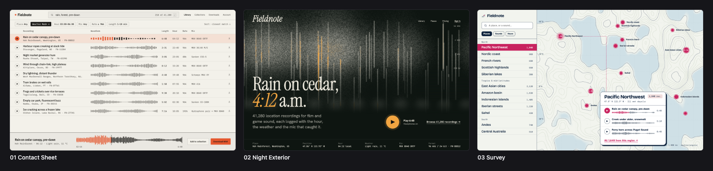
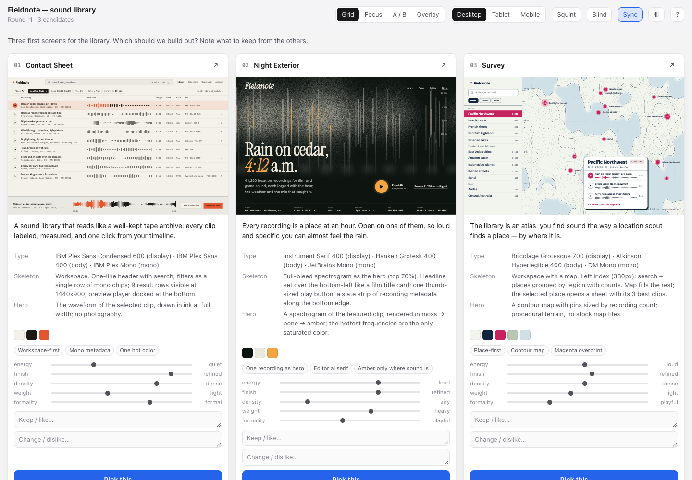

# canvas-ui

**A UI design skill for AI coding agents.** It explores three genuinely different design directions, puts them side by side on a live comparison canvas, lets you tune them with real design tokens, and then refines the chosen one against real screenshots until it holds up. Works in Claude Code, Codex, Gemini CLI, Cursor, OpenCode, and any model that can read a prompt (DeepSeek, GPT, Gemini web).



<sub>One brief (a field-recording library), three directions from different engines: a tape-log workspace, a single recording as hero, a place-first atlas. Built, linted and captured by the bundled tools. Source in [examples/fieldnote](examples/fieldnote/r1).</sub>

## Why it's different

Most "design skills" are a long style guide. canvas-ui is a **workflow plus tools**, and every step produces something you can check:

|                                      |                                                                                                                                                                                                                                                                                                                                                                                |
| ------------------------------------ | ------------------------------------------------------------------------------------------------------------------------------------------------------------------------------------------------------------------------------------------------------------------------------------------------------------------------------------------------------------------------------ |
| **Directions are data**              | Each direction is a `direction.json` card: north star, engine, five tone dials, type, color, skeleton, hero. Not adjectives.                                                                                                                                                                                                                                                   |
| **Dials → tokens**                   | `tokens.mjs` turns a card into ~60 CSS variables (OKLCH color ramps, type scale, spacing, radius, shadow, motion). All text colors pass WCAG AA **by construction**; small type is floored at 12/13px.                                                                                                                                                                         |
| **A canvas you can steer**           | Grid, Focus, A/B with synced scroll, Overlay onion-skin, Squint test, Blind mode, per-candidate keep/change notes, and **live Tune**: drag the dials, recolor, re-scale type — the page re-tokenizes instantly. **Pick** copies a paste-ready instruction for your agent, including your token tweaks.                                                                         |
| **A design lint on the real render** | Every screenshot is checked in the browser for readability bugs (contrast against the _actual_ background, tiny text, tight leading, overflow, clipping, stuck animations, tap targets) and **AI-default tells** (gradient text, emoji icons, eyebrow labels, glow blobs, purple-blue gradients, icon-tile feature grids, nested cards, pills everywhere, default-font-only…). |
| **Divergence is enforced**           | The canvas builder warns when two directions share 2+ of display font, color family, engine and tone. The squint sheet shows when two directions have the same light/dark masses.                                                                                                                                                                                              |
| **Zero dependencies**                | Node scripts + your installed Chrome over raw CDP. No npm install, no Python, no Puppeteer.                                                                                                                                                                                                                                                                                    |
| **Agent-neutral**                    | One `SKILL.md`, plus adapters for Codex, Gemini CLI, Cursor, and a portable prompt for chat-only models.                                                                                                                                                                                                                                                                       |



## Install

**Any agent that supports skills:**

```bash
npx skills add riz007/canvas-ui
```

**Or from a clone:**

```bash
git clone https://github.com/riz007/canvas-ui && cd canvas-ui
./install.sh claude            # ~/.claude/skills/canvas-ui
./install.sh agents            # ~/.agents/skills (Codex + Gemini CLI)
./install.sh cursor --project ~/code/my-app
./install.sh all --link        # symlink everything (for hacking on the skill)
```

| Agent | How it loads | Tested |
| --- | --- | --- |
| Claude Code | Skill in `~/.claude/skills/canvas-ui` (project: `.claude/skills`) | ✅ 2.1 — triggers on design requests, stays out of bug fixes, runs a full canvas round unattended |
| Codex | Skill in `~/.codex/skills` or `~/.agents/skills` (project: `.agents/skills`) | Paths confirmed in Codex 0.164; end-to-end run pending |
| Gemini CLI | Native skill in `~/.gemini/skills` or `~/.agents/skills` (project: `.gemini/skills`). Older builds: `./install.sh gemini-extension` | Paths confirmed in Gemini CLI 0.62; end-to-end run pending |
| Cursor | Project rule `.cursor/rules/canvas-ui.mdc` pointing at the skill | Not yet |
| OpenCode / others | Skill folder, or point your `AGENTS.md` at `SKILL.md` | Not yet |
| DeepSeek, ChatGPT, Gemini web, raw API | Paste [adapters/generic/PROMPT.md](adapters/generic/PROMPT.md) as the system prompt | Not yet |

`./install.sh agents` installs once into `~/.agents/skills`, which both Codex and Gemini CLI read. Don't also install `codex` or `gemini` on top, or the skill is listed twice.

Requirements for the tools: Node 20+ (22+ recommended) and Chrome, Chromium, Edge or Brave. The workflow itself needs nothing.

## Use

Just ask:

- "Use canvas-ui to explore three directions for our booking app's home screen."
- "Redesign this dashboard. Show me options on the canvas first."
- "Recreate this screenshot as HTML, then add a mobile layout."
- "Review our pricing page with canvas-ui. Don't change anything."

What happens:

1. **Directions in words.** The agent names the category and peers, sets the five tone dials with evidence, and writes three direction cards from different _engines_ (a material in a setting, a scene, a character, a movement, another medium's grammar, or rule-breaking). It sends you 3–4 lines each with a recommendation, and asks: build one, or see all three?
2. **The canvas.** If you want to see them, it builds three first screens on generated tokens and opens the canvas. You compare, squint, tune, take notes, and **Pick**. Paste the copied text back.
3. **Build.** Your token tweaks go into the card, and the full UI gets built: real hierarchy, real states, three echoing motions.
4. **Evidence.** Desktop + mobile screenshots, full page, 200% details, motion frame strips, the lint. Every `fix` item is fixed; every `tell` is removed or justified in writing.
5. **Independent review.** A fresh subagent that never saw the build scores it on a five-line rubric (direction, hierarchy, type & color, craft, specificity), and a blind UX walkthrough checks the main flow without being told the path.
6. **Delivery notes**: chosen direction and why, what's not done, motions, review scores, copy removed, tells kept and why, where the evidence lives.

Micro-edits ("make the save button green") skip all of this.

## Tools

```bash
node scripts/tokens.mjs  examples/fieldnote/r1 --specimen       # cards → tokens.css (+ specimen page)
node scripts/canvas.mjs  examples/fieldnote/r1 --open           # build and open the canvas
node scripts/canvas.mjs  examples/fieldnote/r1 --serve 4817     # or serve it for an agent's browser pane
node scripts/shoot.mjs   examples/fieldnote/r1 --sheet --squint # capture all, contact sheet, squint test, lint
node scripts/shoot.mjs   page.html --size desktop,mobile --full
node scripts/shoot.mjs   page.html --steps 'open: click .menu; filled: type #q "rain"' --size mobile
node scripts/shoot.mjs   page.html --compare reference.png --size 1280x800   # recreation diff
node scripts/shoot.mjs   page.html --steps "click .play" --frames 8          # motion strip
```

Each script has `--help`. Details: [references/tools.md](references/tools.md).

## What's inside

```
SKILL.md                    the workflow (what the agent reads)
references/
  direction.md              category & benchmarks, tone dials, engines, color, cards, divergence test
  tokens.md                 the token engine and how to use tokens in Tailwind / CSS / existing systems
  visual-language.md        hierarchy, type, color, controls, subtraction
  layout.md                 persuasion skeletons, workspace layouts, viewports, exact recreation
  motion.md                 three basic motions, feel → springs, durations, scroll
  canvas.md                 building candidates, manifest, reading a pick
  review.md                 reviewer dispatch, /10 rubric, blind UX walkthrough
  slop.md                   lint rules, AI-default tells, tells the lint can't see
  tools.md · workspace.md
scripts/                    tokens.mjs · canvas.mjs · shoot.mjs · lib/ (token engine, CDP, lint)
assets/canvas.html          the canvas template
templates/direction.json    the direction card schema, annotated
adapters/                   Codex · Gemini CLI · Cursor · portable prompt
examples/fieldnote/r1       a complete direction round, with shots
tests/                      node --test (token guarantees, canvas build, lint on a real browser)
```

## Develop

```bash
npm test            # 10 tests; the browser test is skipped if no Chrome is found
npm run example     # regenerate the example's tokens and open its canvas
```

Pro features are planned; see [ROADMAP.md](ROADMAP.md). The core skill will stay MIT and complete on its own.

## License

[MIT](LICENSE)
